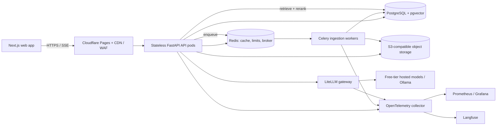

# Lumen

Lumen is an enterprise retrieval-augmented generation (RAG) platform designed for tenant-isolated document ingestion, hybrid search, cited answers, and operational resilience. This repository is being built in the phases described below; components marked as planned are not yet implemented or production-ready.

## Architecture



**Request flow:** uploads are stored in object storage and queued; workers parse, clean, chunk, embed, and index documents asynchronously. Search combines PostgreSQL vector and full-text retrieval using reciprocal-rank fusion (RRF), applies tenant and document ACL predicates in SQL, reranks candidate chunks, and streams grounded answers with citations over SSE.

**State and scaling:** API pods are stateless. PostgreSQL is the system of record, Redis provides ephemeral coordination/cache/queues, and object storage holds raw files. Background ingestion and synchronous query workloads use separate worker pools and resource limits. PostgreSQL row-level security (RLS) is defense in depth; application queries still include explicit tenant and ACL filters.

## Repository layout

```text
apps/
  api/       FastAPI application
  web/       Next.js application
  worker/    Celery ingestion worker
infra/       Local compose, Kubernetes/k3s, and deployment configuration
eval/        Retrieval and answer evaluation data and harness
docs/
  adrs/      Architecture decision records
  runbooks/  Operational procedures (planned)
```

## Technology baseline

The implementation follows the requested stack: Python 3.12, FastAPI, SQLAlchemy 2 async, Alembic, Pydantic v2, Celery/Redis, PostgreSQL/pgvector, FastEmbed (BGE-small), LiteLLM, and Next.js App Router with TypeScript and Tailwind. Optional integrations must have a free/open-source development path; hosted free tiers are best-effort and subject to provider quotas and terms. Ollama is the local model fallback. No paid service is required for local development.

## Delivery phases

0. Architecture, ADRs, and repository scaffold (this phase)
1. Authentication, tenancy, and database schema
2. Asynchronous ingestion pipeline
3. Hybrid retrieval, reranking, and streaming answers
4. Caching, rate limits, and resilience
5. Evaluation harness and CI regression gates
6. Observability
7. Frontend application
8. Scroll-story landing page and 3D experience
9. Load testing and tuning
10. Deployment and operational documentation

## Development

The local compose stack and one-command startup are introduced with the runnable services in later phases. Until then, this scaffold is documentation-only and is not a runnable application. See [the ADRs](docs/adrs/) for the decisions that constrain implementation.

## Performance and security targets

The scale objectives are 1 million registered users, 5,000 concurrent users, 500 search RPS, retrieval p95 below 400 ms, and answer first-token latency below 1.5 s. These are targets, not claims of demonstrated capacity. Phase 9 will provide a reproducible k6 workload, environment details, raw results, and an honest comparison to each target.

The security baseline includes tenant isolation enforced by PostgreSQL RLS, document-level ACL filtering inside retrieval SQL, Argon2 password hashing, short-lived access tokens and rotating refresh tokens, OIDC, RBAC, audit logging, prompt-injection defenses, and managed secret handling. See [the initial threat model](docs/threat-model.md).
